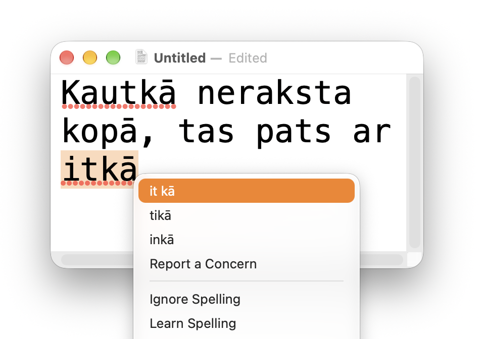

# Pareizrakstība

Service that adds support for system-wide spell checking in the Latvian language for the macOS operating system.



## Requirements

- macOS 12+
- Universal (Intel & Apple Silicon)
- Tested on macOS 27 and macOS 12

## Installation

- [Download latest release](https://github.com/WARP-LAB/Pareizrakstiba/releases/latest/download/Pareizrakstiba.dmg), or here are [release notes](https://github.com/WARP-LAB/Pareizrakstiba/releases/latest/) and you can find DMG under Assets
- Mount DMG and run `Pareizrakstiba.pkg` installer, it will guide you through the process

## Uninstallation

- [Download latest release](https://github.com/WARP-LAB/Pareizrakstiba/releases/latest/download/Pareizrakstiba.dmg)
- Mount DMG and run `Uninstall Pareizrakstiba`, it will guide you through the process

## Usage

- Check out official Apple macOS User Guide for [Check spelling and grammar on Mac](https://support.apple.com/en-gb/guide/mac-help/mchlp2299/mac)
- Covers all apps that use the macOS spelling engine. A quick way to detect support is if the app has _Edit : Spelling and Grammar_ menu entry. Only some don't.
- In applications, make sure that Latvian spellcheck is selected in _Edit : Spelling and Grammar : Show Spelling and Grammar → Latviešu (Pareizrakstiba)_
- Play around with settings under _System Settings : Keyboard : Input Sources → Edit…_ Here is also _Spelling_ dopdown where you can set preferred default spelling language. For older macOS versions settings can be found in _System Preferences : Keyboard : Text_.
- _LibreOffice_ et al. users have no need to download and install dictionaries from within these apps, as the mentioned applications use the macOS system-wide spell checking. Besides, when using Pareizrakstība in the applications and adding new words, they will apply to the whole OS.
- Rich text content in _Google Docs, Sheets & Slides_ on _Safari_, _Chrome_ and others cannot be _reached_ by the macOS system-wide spell checking because of how these webapps are built.
- Spelling learned by the user is kept in `~/Library/Spelling/` for the user.
- The shortcut for the rarely used autocompletion list is either `Option+Esc` or `F5` (before Mac OS X 10.6 it was `Esc`).

## Installation side effects

Upon installation, Pareizrakstība checks for and removes all previous versions.

## Older OS support

- macOS 10.13+ Universal [v4.1.0](https://github.com/WARP-LAB/Pareizrakstiba/releases/tag/v4.1.0)
- Mac OS X 10.4 to Mac OS X 10.9 Intel 32 & 64-bit [Pareizrakstiba-Archive](https://github.com/WARP-LAB/Pareizrakstiba-Archive)

## Spelling configuration via CLI

A few one-liners to avoid digging through deeply buried checkboxes in macOS Settings.

```zsh
# Disable automatic language detection
defaults write NSGlobalDomain NSSpellCheckerAutomaticallyIdentifiesLanguages -bool FALSE

# Try to force Latvian as the default language when launching applications
defaults write NSGlobalDomain NSPreferredSpellServerLanguage 'lv'

# Disable system-wide autocorrect
defaults write NSGlobalDomain NSAutomaticSpellingCorrectionEnabled -bool FALSE
```

## Version history

See [CHANGELOG.md](https://github.com/WARP-LAB/Pareizrakstiba/blob/master/CHANGELOG.md).

## Uses

- [Hunspell](https://hunspell.github.io)
- [Latvian language Hunspell dictionaries](https://dict.dv.lv/home.php?prj=lv)
